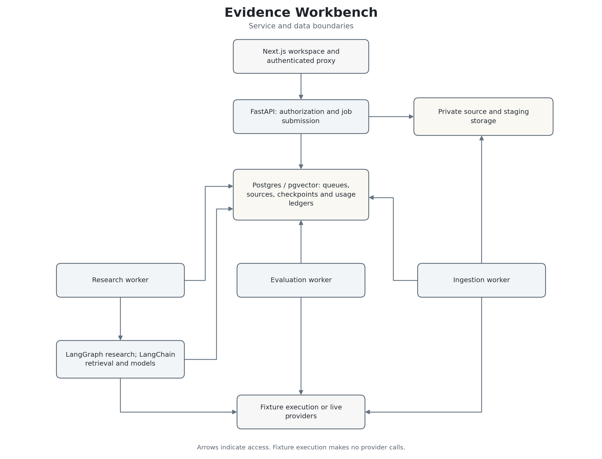

# Evidence Workbench

**Ask a research question. Approve the plan. Inspect the evidence behind the answer.**

A research workspace that turns a document collection into a cited report through a bounded, inspectable investigation. Built with Next.js, FastAPI, LangGraph, and PostgreSQL/pgvector.

[Run locally](#running-the-application) · [Reviewer walkthrough](#five-minute-reviewer-walkthrough) · [Features](#features-to-explore)

## TL;DR

- **Run locally with Docker Compose:** one startup command; no API keys, cloud account, or host Python/Node installation required.
- **Review the investigation:** edit its plan, follow saved activity, and inspect the passages supplied to each model call.
- **Trace the answer:** numbered citations open exact passages from immutable document versions; export the report as Markdown.
- **Explore the engineering:** hybrid search, durable workers, approval checkpoints, shared budgets, cancellation, and three research strategies.
- **Know what the demo proves:** responses and topic vectors are scripted fixtures; database search and workflow execution are real. Live AI and public-web adapters are implemented separately and require opt-in configuration.

## Running the application

### Prerequisites

- **Docker installed and running:** Docker Desktop on macOS/Windows, or Docker Engine with Compose v2 on Linux. Installing Docker alone is not enough; its engine must be running before startup.
- **A Bash terminal:** use your terminal on macOS/Linux. On Windows, use WSL2 with Docker Desktop integration enabled.
- **The repository:** clone it with Git, or download and extract its ZIP. Git is optional if you use the ZIP.
- **Internet access for the initial build**, available ports **3000**, **8000**, and **55432**, and disk space for Docker images, dependencies, and local data. Exact minimum RAM and disk requirements have not been benchmarked.

**No host Python, Node.js, database installation, API keys, or cloud account is required.** The default local demo uses synthetic documents and scripted responses, with no paid AI calls. Live AI is optional; see [Live mode and scope](#live-mode-and-scope).

### Start

Clone the repository, then enter its root—the directory containing [compose.yaml](./compose.yaml):

```bash
git clone https://github.com/no-complect/evidence-workbench.git
cd evidence-workbench
```

If you downloaded the ZIP instead, open a terminal in the extracted directory. Start the application with:

```bash
bash scripts/dev.sh --no-follow
```

The first build may take several minutes. The startup command automatically:

1. Creates a local `.env` from the included example if one does not already exist.
2. Builds the containers and installs the locked application dependencies inside them.
3. Starts PostgreSQL, applies database migrations, and loads the synthetic example documents.
4. Starts the API, separate research and evaluation workers, and the website, then waits for service readiness.

When startup succeeds, open **[http://localhost:3000](http://localhost:3000)**. No configuration edits or sign-in are needed for a fresh local demo. Continue with the [reviewer walkthrough](#five-minute-reviewer-walkthrough) below.

The application runs in the background; closing this terminal does not stop it. If another copy is already running, stop that copy first to free the same ports.

### Stop and restart

Run these commands from the repository root:

```bash
# Stop the application and retain its database and uploaded documents.
bash scripts/stop.sh

# Start it again using the retained data.
bash scripts/dev.sh --no-follow
```

### If startup fails

Make sure Docker is running, then inspect the services and logs:

```bash
docker compose ps
docker compose logs --tail=100 api worker eval-worker web
```

See [Troubleshooting](./docs/TROUBLESHOOTING.md) for Docker access, port conflicts, build failures, and queued research.

## Five-minute reviewer walkthrough

After the initial build:

1. Open **Workflows**, select the **Enterprise AI architecture** project and **Architecture decision pack** collection. Keep the default question comparing managed, self-hosted, and hybrid AI assistants.
2. Click **Start research**. When the plan appears, edit the security question to `security retention current requirements`, then click **Approve & investigate**.
3. Open **Research trail** to follow saved execution events. Open **Evidence board**, select a finding, and inspect its pinned passage or explicit limitation. **Inspect provenance** opens the full source details.
4. Open **Decision brief**, click a numbered citation, and inspect its source version, section, offsets, and exact text. Click **Markdown** to download the report.
5. Open **Context** to inspect a recorded model input, prompt version, and evidence inclusion/exclusion decisions.
6. Open **RAG**, choose **New collection**, and follow **Purpose → Sources → Review → Try it**. Use the synthetic architecture pack to prepare real bundled documents without paid calls, or bring your own files. Search with **Keyword**, **Vector**, or **Hybrid**, then inspect a result’s passage, ranks, version, and content hash. Custom fixture uploads support Keyword search; Vector requires a recognized fixture topic.
7. Upload [reviewer-notes.txt](./docs/examples/reviewer-notes.txt). Its status should become `ready`. New demo uploads are full-text searchable; arbitrary research questions require live mode.

For a terminal-only investigation:

```bash
bash scripts/demo.sh
```

For optional command-line benchmarks:

```bash
bash scripts/eval.sh --split held-out
# Or run the full fixture comparison:
bash scripts/eval.sh
```

In the **Evaluations** workspace, choose a case split and select **Run benchmark**. The dedicated evaluation service queues the comparison, reports progress, supports cancellation, and saves aggregate and case-level results. No terminal command is needed.

The optional CLI commands above run inside the evaluation container and submit cases to the independent research worker, exporting local results to `evals/results/`. A [saved fixture comparison](./docs/examples/fixture-comparison.md) and its [raw data](./docs/examples/fixture-comparison.json) are included for inspection without running the suite. They are historical demo measurements, not live-model benchmarks or a certification of the current checkout.

## Features to explore

- **Harness:** connect a local OpenAI account, discover its model catalog, explicitly verify research contracts, and save immutable planner/reviewer/writer model targets with budgets. Inspect the selected run’s pinned targets, execution limits, and saved prompt/context fingerprints.
- **RAG:** create collections through a guided walkthrough, inspect per-file ingestion results and retries, and compare real keyword/vector/hybrid retrieval with pinned provenance. Collection preparation can resume after interruption; completed retries reuse the collection without resetting later source updates. Embedding profiles are immutable; changing the embedding model requires a new collection. Markdown, UTF-8 text, and text-based PDF uploads are limited to 8 MiB per file, 20 files per batch, and PDFs to 200 pages. Failed replacements preserve the last usable source version.
- **Workflows:** run investigations, approve an edited plan, inspect **Decision brief**, **Evidence board**, **Research trail**, and **Context**. Findings retain citations and limitations; passage inspectors expose source identity and unavailable references. Redacted assembled inputs retain prompt hashes, token estimates, and evidence selection decisions. Private chain-of-thought is not requested or displayed.
- **Evaluations:** queue, cancel, and inspect comparisons of basic RAG, a fixed workflow, and bounded follow-up research.

Workspace changes preserve in-progress form and approval edits. Selecting another project resets that project's local workflow state. Closing the browser does not cancel a background investigation.

In **Research settings**, compare the three strategies, choose 1–3 concurrent gathering tasks, change retrieval depth, and set iteration, tool-call, token, time, and estimated-cost limits. Plan review is enabled by default. **Cancel** retains gathered evidence; a limit can produce a visibly partial report. To demonstrate a budget stop, start a new investigation with the token budget set to 500.

Demo questions cover deployment comparison, security controls, operating costs, stale/contradictory evidence, and missing million-user latency evidence. Use the supplied examples: unsupported questions receive an explanation rather than a fabricated answer.

## How it works



[Open scalable diagram](./docs/diagrams/architecture.svg) · [Editable Mermaid source](./docs/diagrams/architecture.mmd)

The browser submits research to the API, which queues it in Postgres. The independent worker executes the research loop, retrieves evidence, and saves progress for the browser to inspect.

The loop is **validate → plan → approval → gather → assess → follow up or write → verify citations → finalize**. Basic RAG searches one task without follow-ups; the fixed workflow researches planned subquestions once; bounded research can investigate gaps in further rounds.

Runs pin document versions at submission, preserving old citations after uploads change. Postgres leases schedule work; LangGraph checkpoints resume it. Parallel tasks share database-enforced budget reservations. External calls can repeat in a crash window; this is not exactly-once inference.

The demo uses ten original synthetic documents and 41 precomputed, 16-dimensional topic vectors. Real SQL combines vector and full-text rankings through reciprocal-rank fusion. Unrecognized uploaded passages use full-text search only. A reranker is explicitly disabled.

## Live mode and scope

Configure `OPENAI_API_KEY` on the server. Local Docker reads it from the root
`.env`; hosted runtimes read their environment variables. **Harness** automatically
loads the models returned for that key. Choose any listed model and the selection
carries into **Workflows → Research settings → Live**. **Refresh models** reloads
the current catalog. There is no key-entry form, connection creation, paid preflight
check, or saved revision required. Model discovery makes no inference calls and
works while live execution is disabled.

Set `LIVE_ENABLED=true` to opt into paid execution. `OPENAI_MODEL` supplies the
initial selection when that ID exists in the returned catalog. The selected model
is pinned in each queued run for planner, reviewer and writer calls, together with
its prompt/contract/context policy and limits. Changing the default does not alter
queued jobs. The key remains in the server environment and is read by the API and
worker; new jobs never copy it into the database, browser, logs or model context.
Restart local services or redeploy after changing environment values.

All returned model IDs are listed without a family filter. Listing does not prove
inference permission or compatibility: research needs a chat model that supports
strict structured output. Unsupported models produce a visible execution error,
with no scripted fallback. Live RAG still requires a separately ingested live
collection using `text-embedding-3-small` vectors. Live ingestion invokes paid
embeddings outside the research-run budget.

Model and embedding prices are optional server estimates. When estimates are
missing, dollar totals are shown as unavailable; token, tool, iteration and time
limits still apply. A dollar cap cannot bound unpriced calls. Model price estimates
apply only to `OPENAI_MODEL`, never silently to another selected model. Optional
Tavily/public-page research still requires its server key and per-call estimate.
Existing saved connection/revision APIs and queued snapshots are retained for
compatibility, but are not part of the current setup or UI.

Harness opens as a configuration studio: edit an additional system instruction,
choose balanced or strict context assembly, select optional per-stage models, and
inspect the actual planner/reviewer/report schemas. **Validate sample** uses the
same Pydantic contracts as execution, without a model call. The contract selector
is an inspector; it does not replace the workflow's per-stage output contracts.
Configuration drafts survive workspace navigation and reset at project/user boundaries.
Saved runs keep the original configuration and effective prompt hashes.

**Workflows → Execution** shows the real LangGraph structure with reviewed tasks,
saved stage events, and assembled context in a node inspector. The decision brief
keeps unresolved findings beside evidence-linked claims. Empty nodes describe the
workflow definition and are not presented as simulated execution.

**Evaluations** supports the built-in fixture benchmark and a collection-specific
case editor. A submitted collection comparison freezes source version IDs, explicit
source/disclosure expectations, per-run limits, and the chosen harness configuration;
a separate evaluation worker coordinates basic RAG, fixed workflow, and bounded
research through the research queue. Live cases also pin model targets at submission
and require an explicit paid-call acknowledgment. Scripted cases are restricted to
the seeded questions and fixture embedding profile. The browser currently authors
one to six cases per comparison, with three strategy runs per case. Each result
shows the submitted question, expected evidence and measured checks; Open case
selects the exact saved investigation for report, citation and context inspection.
Failed quality checks remain visible even when the evaluation worker completes.
Collection retrieval metrics use
the top five retained evidence passages by RRF score and ID; fixture benchmarks use
an independent retrieval probe. Source labels are human expectations and disclosure
checks are lexical. Cases labeled as having no supporting evidence check whether
the report abstains from claims. No independent semantic judge is claimed.

OpenAI is the first adapter; other provider APIs are not implemented. Provider tests
use synthetic responses; paid account access must be verified in the operator’s
installation. Live comparisons make paid model and retrieval calls within each
research run's bounded execution. When prices are absent, dollar caps cannot bound
those unpriced calls.

The hosted configuration uses Supabase Auth, project membership checks, RLS, and private Storage. A read-only MCP server exposes corpus search, evidence lookup, and run status. See [Deployment and configuration](./docs/DEPLOYMENT.md).

**Limits:** synthetic prices are not vendor facts; exact-quote verification does not establish semantic correctness of model synthesis. Cancellation and deadlines are cooperative. OCR, invitation UI, production rate limiting, and automated retention are not implemented. Hosted authentication/storage and paid provider behavior need separate verification before production use.

## For developers

Commit both [uv.lock](./uv.lock) and [apps/web/package-lock.json](./apps/web/package-lock.json); normal installs use frozen dependencies. Host development requires Python 3.12+, uv, and Node 24. The reviewer demo needs only Docker.

- [Development and tests](./docs/DEVELOPMENT.md)
- [Verification status and remaining checks](./docs/BUILD_STATUS.md)
- [Architecture, authorization, context, and recovery](./docs/ARCHITECTURE.md)
- [Evaluation methodology](./docs/EVALUATION.md)
- [Contributing](./CONTRIBUTING.md) · [Security](./SECURITY.md) · [Preparing a public release](./docs/RELEASING.md)

## Repository guide

- [apps/web](./apps/web/) — website and API proxy.
- [services/research/workbench](./services/research/workbench/) — API, worker, and research engine.
- [db/migrations](./db/migrations/) — database schema and authorization policies.
- [packages/contracts](./packages/contracts/) — generated shared request/report types.
- [fixtures](./fixtures/) — synthetic documents and demo vectors.
- [prompts](./prompts/) — versioned model instructions.
- [evals](./evals/) — evaluation cases and local result exports.
- [tests](./tests/) and [apps/web/e2e](./apps/web/e2e/) — backend and browser verification.
- [.env.example](./.env.example) — configuration template used by startup.

## License

[MIT](./LICENSE). The synthetic corpus is original demonstration material and contains no employer data. Dependencies retain their own licenses.
